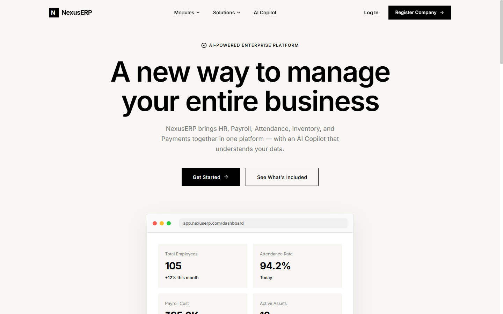
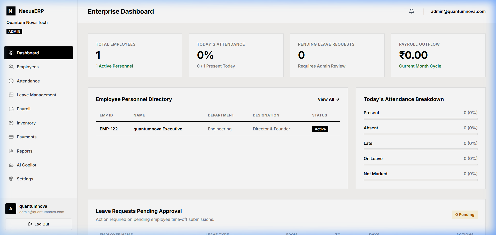
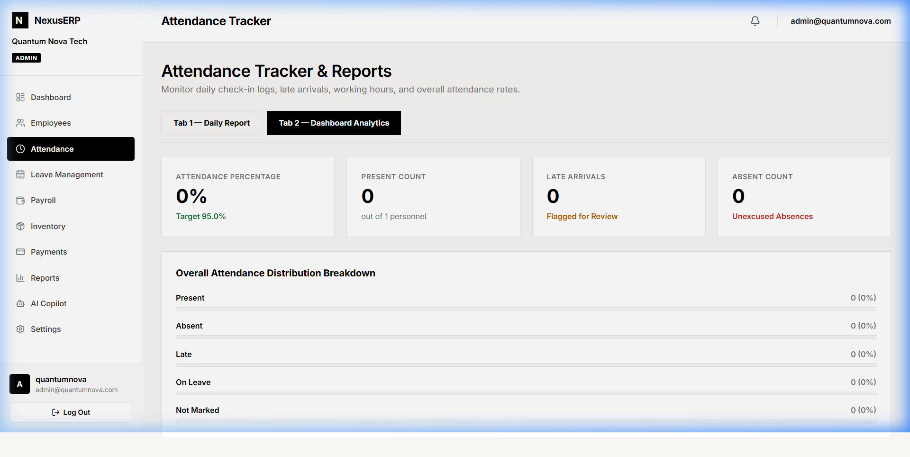

# NexusERP-AI – Enterprise Workflow & Intelligent HRMS Platform

[](https://www.python.org/)
[](https://www.djangoproject.com/)
[](https://www.django-rest-framework.org/)
[](https://react.dev/)
[](https://www.typescriptlang.org/)
[](https://www.postgresql.org/)
[](https://vitejs.dev/)
[](https://opensource.org/licenses/MIT)

---

## Overview

**NexusERP-AI** is a cloud-native, multi-tenant Enterprise Resource Planning (ERP) and Human Resource Management System (HRMS) engineered to centralize, automate, and streamline organizational workflows. Built on a strict tenant-isolated architecture powered by Django REST Framework and React with TypeScript, the platform unifies employee lifecycle management, biometric-grade attendance tracking, multi-tier leave administration, algorithmic payroll calculation, hardware asset auditing, and outbound financial disbursements into a unified single-pane interface. By integrating an autonomous AI Copilot with tool-calling capabilities (supporting both high-speed cloud inference via Groq and private on-premises execution via Ollama), NexusERP-AI transforms operational business data into predictive, actionable intelligence.

---

## Application Previews

### 1. Modern Enterprise Landing Experience


### 2. Multi-Tenant Executive Dashboard


### 3. Attendance Analytics & Audit Studio


---

## Core Modules

- **Multi-Tenant Identity & Automated Workspace Bootstrap**: Guarantees zero cross-tenant data contamination. Registering a new enterprise instantly bootstraps standard organizational structures, including 5 functional departments (Engineering, HR, Finance, Operations, Sales), standardized designations, and statutory leave policies.
- **Employee Directory & Personnel Management**: Comprehensive personnel profiles, role-based access control (Admin, HR, Manager, Employee), role resolution safeguards, and contact verification.
- **Attendance Tracking & Time-Clock Studio**: Daily check-in/check-out logs, real-time working hour calculations, grace-period late tracking, and unified daily distribution reports.
- **Leave Management Studio**: Entitlement balance tracking across Casual, Sick, and Paid leave categories, employee request workflows, and instant manager approvals/rejections with automated balance reconciliation.
- **Automated Payroll & Payslip Engine**: Parameterized salary computations (Base Salary, HRA, Special Allowances, PF, Professional Tax, and Deductions) with single-click batch generation and PDF payslip exporting.
- **Hardware & Asset Inventory**: Enterprise asset allocation, custodian tracking, serial number auditing, and condition monitoring.
- **Payments & Outbound Expense Hub**: Vendor disbursements, invoice records, expense approvals, payment status audits, and transaction logs.
- **Executive Analytics & Reports Studio**: Real-time reporting engine delivering departmental breakdowns, payroll commitments, attendance metrics, and downloadable operational datasets.
- **NexusERP AI Copilot**: Autonomous conversational assistant utilizing schema-validated LLM tool calling to answer queries, analyze trends, inspect employee metrics, and assist executive decision-making.

---

## AI Attendance-Risk Feature

### How It Works
The **AI Attendance-Risk** feature is a predictive analytics mechanism designed to identify emerging absenteeism and attrition signals before they affect operational delivery or payroll accuracy.

```
+--------------------------------------------------------------------------------+
|                           DATA COLLECTION & EXTRACTION                         |
|  - Rolling 30-Day Check-in / Check-out timestamps                              |
|  - Late Arrival frequency & grace-minute deviations                            |
|  - Unexcused absences vs. Approved leave patterns                              |
|  - Monday/Friday proximity correlations                                        |
+--------------------------------------------------------------------------------+
                                       |
                                       v
+--------------------------------------------------------------------------------+
|                         PREDICTIVE RISK SCORING ENGINE                         |
|  - Score 00 - 29 (Low Risk): Stable punctuality, excused leaves only           |
|  - Score 30 - 69 (Medium Risk): Moderate late arrivals, sporadic unexcused off |
|  - Score 70 - 100 (High Risk): Chronic tardiness, clusters of missed days      |
+--------------------------------------------------------------------------------+
                                       |
                                       v
+--------------------------------------------------------------------------------+
|                          AUTONOMOUS AI COPILOT ACTIONS                         |
|  - Surfaces high-risk employees in executive queries                           |
|  - Proposes proactive check-in meetings for managers                           |
|  - Recommends shift adjustments or leave balance audits                        |
+--------------------------------------------------------------------------------+
```

1. **Feature Engineering**: The backend aggregates check-in timestamps, working durations, consecutive unexcused absences, and late arrival minutes against company-defined grace periods.
2. **Behavioral Pattern Recognition**: Detects anomalies such as repeated patterns of absent days directly before or after weekends and holidays.
3. **Risk Stratification**: Employees are classified into Low, Medium, and High Risk tiers, highlighting personnel requiring support, workload re-balancing, or policy intervention.
4. **Autonomous Copilot Recommendations**: When queried through the AI Copilot (`"Show me attendance risks for Engineering"`), the copilot executes live tool calls against the database, summarizes the risk indicators, and generates recommended actions for HR leaders.

---

## Technology Stack

| Layer | Technologies |
| :--- | :--- |
| **Frontend** | React 19, TypeScript, JavaScript (ESNext), Vite, Tailwind CSS, Lucide Icons, Axios |
| **Backend** | Python 3.12, Django 6.0, Django REST Framework (DRF), SimpleJWT, Django-Filter |
| **Database** | PostgreSQL 16+ (ACID compliant, relational schemas, indexed foreign keys, multi-tenant isolation) |
| **AI / LLM** | Groq API (`llama-3.3-70b-versatile`), Ollama (`qwen2.5` / `llama3`), Tool Calling / Function Calling |
| **Security** | JWT Authentication with token rotation, CORS origin isolation, Argon2/PBKDF2 hashing, zero credential leaks |

---

## Local Setup & Installation

### Prerequisites
- **Python 3.12+**
- **Node.js 20+** and **npm**
- **PostgreSQL 14+** running locally or in cloud
- *(Optional)* **Ollama** installed locally OR a free **Groq Cloud API Key** for AI features

---

### 1. Clone the Repository
```bash
git clone https://github.com/krishpatelkp/NexusERP-AI.git
cd NexusERP-AI
```

---

### 2. Configure PostgreSQL Database
Open PostgreSQL via `psql` or pgAdmin and create the database:
```sql
CREATE DATABASE nexuserp;
```

---

### 3. Backend Setup

1. **Navigate to the backend directory and activate a virtual environment:**
   ```bash
   cd backend
   python -m venv venv
   
   # Windows (PowerShell):
   .\venv\Scripts\Activate.ps1

   # Linux / macOS:
   source venv/bin/activate
   ```

2. **Install Python dependencies:**
   ```bash
   pip install -r requirements.txt
   ```

3. **Configure Environment Variables:**
   Copy `.env.example` to `.env`:
   ```bash
   cp .env.example .env
   ```
   Edit `.env` with your PostgreSQL credentials:
   ```env
   SECRET_KEY=your-dev-secret-key-change-in-production
   DEBUG=True
   ALLOWED_HOSTS=*
   
   DB_NAME=nexuserp
   DB_USER=postgres
   DB_PASSWORD=your_postgres_password
   DB_HOST=localhost
   DB_PORT=5432
   
   CORS_ALLOWED_ORIGINS=http://localhost:3000,http://127.0.0.1:3000
   
   # Optional AI Copilot Configuration:
   # GROQ_API_KEY=gsk_your_groq_key_here
   # GROQ_MODEL=llama-3.3-70b-versatile
   ```

4. **Run Migrations & Seed Default Workspace:**
   ```bash
   python manage.py migrate
   ```

5. **(Optional) Run System Verification Suite:**
   Verify end-to-end multi-tenant isolation, leave balance deductions, and attendance APIs:
   ```bash
   python verify_system.py
   ```

6. **Start the Django Development Server:**
   ```bash
   python manage.py runserver 127.0.0.1:8000
   ```
   The backend API will be live at `http://127.0.0.1:8000/api/`  
   Interactive Swagger documentation is available at `http://127.0.0.1:8000/swagger/`

---

### 4. Frontend Setup

1. **Open a new terminal and navigate to the frontend directory:**
   ```bash
   cd frontend
   ```

2. **Install Node packages:**
   ```bash
   npm install
   ```

3. **Configure Environment Variables:**
   Copy `.env.example` to `.env`:
   ```bash
   cp .env.example .env
   ```
   Ensure `VITE_API_URL` points to your running backend:
   ```env
   VITE_API_URL=http://127.0.0.1:8000/api
   ```

4. **Start the Vite Development Server:**
   ```bash
   npm run dev
   ```
   The frontend application will be live at `http://localhost:3000`

---

## GitHub Repository "About" Section Details

When updating the repository metadata on GitHub:

- **Description (one-line):**  
  `Enterprise-grade multi-tenant HRMS & ERP platform powered by React, TypeScript, Django REST Framework, PostgreSQL, and an autonomous AI Copilot.`

- **Website / Live Demo:**  
  `https://nexuserp.vercel.app` *(or your production URL)*

- **Topics:**  
  `django` `react` `typescript` `erp` `postgresql` `hrms` `attendance-system` `payroll-management` `inventory-management` `artificial-intelligence`

---

## Security & Credential Hygiene

- **Zero Secret Commits**: All sensitive parameters (`SECRET_KEY`, `DB_PASSWORD`, API tokens) are strictly read via OS environment variables and `.env` files.
- **Git History Verified**: Repository history has been verified to ensure zero `.env` files or database credentials were ever tracked or committed.
- **Multi-Tenant Protection**: Every database query is strictly filtered by the authenticated user's `company_id`. Cross-tenant data leakage is prevented at both the ORM and serializer layers.

---

## License

This project is licensed under the [MIT License](LICENSE).
